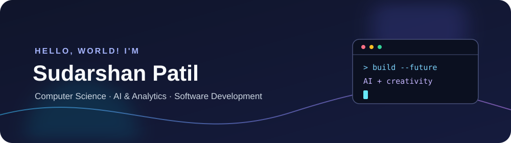
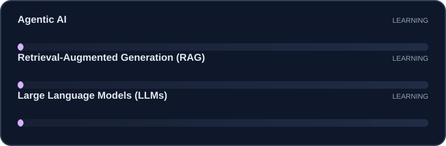

  
   
  

## About Me

I'm a third-year **B.Tech Computer Science Engineering (AI & Analytics)** student at **MIT ADT University**, interested in building useful software and exploring how AI can make it smarter. I enjoy coding, learning new technologies, and turning ideas into projects.

- 📍 Pune, Maharashtra, India
- 🎓 MIT ADT University — 2024–2028
- 💼 Seeking internships in **AI/ML, Data Analytics, Generative AI, or Software Development**
- 📧 [Email me](mailto:sudarshanpatil7385@gmail.com)
- 💼 [LinkedIn](https://www.linkedin.com/in/sudarshan-patil-561421332/)

## Skills

- **Programming:** Python, C, C++, JavaScript
- **Web:** HTML, CSS, JavaScript
- **AI & ML:** Machine Learning, Generative AI, NLP
- **Data:** Pandas, Exploratory Data Analysis (EDA)
- **Tools & Development:** Streamlit, Git, GitHub, API Integration
- **Cloud:** AWS Bedrock

## Currently Learning

Exploring these areas through coursework, hands-on practice, and personal projects:

  

## Projects

### AI Career Assistant *(Ongoing)*
**Python · Streamlit · Generative AI**

Developing a Streamlit application that analyzes uploaded resumes with generative AI. Planned features include resume feedback, career-role suggestions, skill-gap analysis, and interview-question generation.

### RAG-Based Intelligent Document Q&A System *(Ongoing)*
**Python · AWS Bedrock · Retrieval-Augmented Generation**

Developing a document question-answering application with document processing, relevant-context retrieval, and AI-generated answers grounded in uploaded documents.

## Certifications

- Generative AI & AI Agents with Amazon Bedrock — AWS
- Generative AI Applications with Amazon Bedrock — AWS
- RAG and Agentic AI — IBM
- Agentic AI Certified Foundations Associate — Oracle
- Foundations of Data Science — Google
- Software Engineering Job Simulation — JPMorgan Chase & Co. (Forage)
- AI for Everyone — DeepLearning.AI
- Operating Systems Basics — Cisco Networking Academy
- Generative AI: Introduction and Applications — IBM
- Introduction to Artificial Intelligence — IBM

## Achievements

- Received a **National Award for Leadership & Team Management**, recognizing leadership, team coordination, and project delivery.
- Authored and published a research paper in the AI domain during the first year of undergraduate study.

## Relevant Coursework

Artificial Intelligence · Machine Learning · Data Structures & Algorithms · Database Management Systems · Operating Systems · Computer Networks · Cloud Computing · Probability & Statistics · Software Engineering

## Connect

- [LinkedIn](https://www.linkedin.com/in/sudarshan-patil-561421332/)
- [GitHub](https://github.com/sudarshanpatil7385-byte)
- [Email](mailto:sudarshanpatil7385@gmail.com)

  

